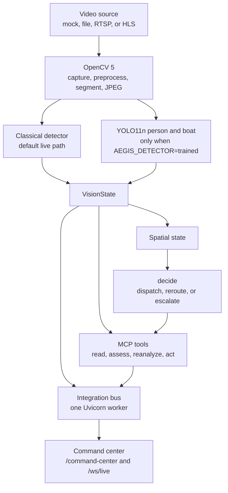

# Aegis architecture

Aegis turns one video frame into a rescue decision and shows that decision to an operator. OpenCV 5 acquires and prepares the frame. A detector writes a `VisionState`. `decide()` picks at most one action. The command center renders the frame, the spatial state, and the action trace. No tool moves hardware.

The live default stays classical. Setting `AEGIS_DETECTOR=trained` selects local weights at `data/training/runs/person-boat-sds/weights/best.pt` with confidence 0.45. Those weights are not in git and are not in the cloud image.

Kinesis Video is a separate plan in `infra/aws/kinesis-stream.yaml`. The organization service control policy denies `kinesis` and `kinesisvideo`, so that stream was not created. The running task does not read a drone stream. Graviton and COOL were not measured. The task is x86 Fargate, and `AEGIS_DEPLOYMENT_VERIFIED` stays false.

A missing geographic fix, including coordinates `0,0`, never becomes a dispatch or reroute target. Blur and occlusion force human review. `hardware_executed` is always false.
