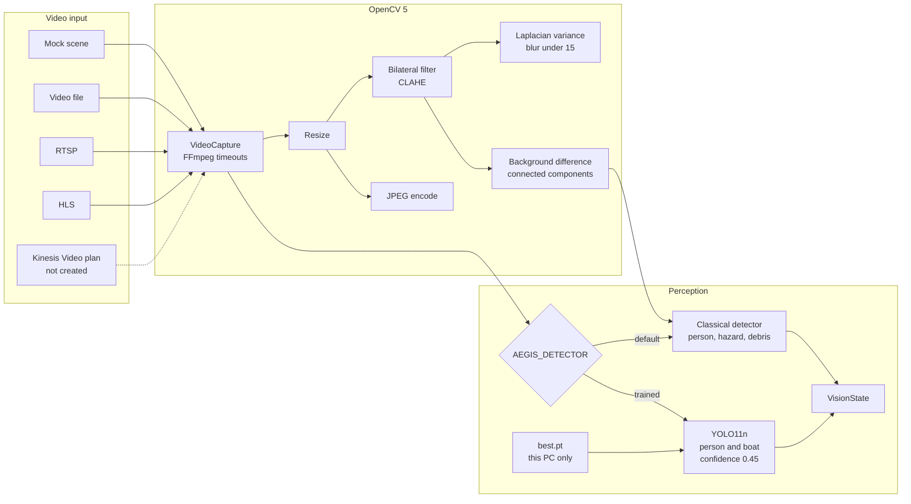
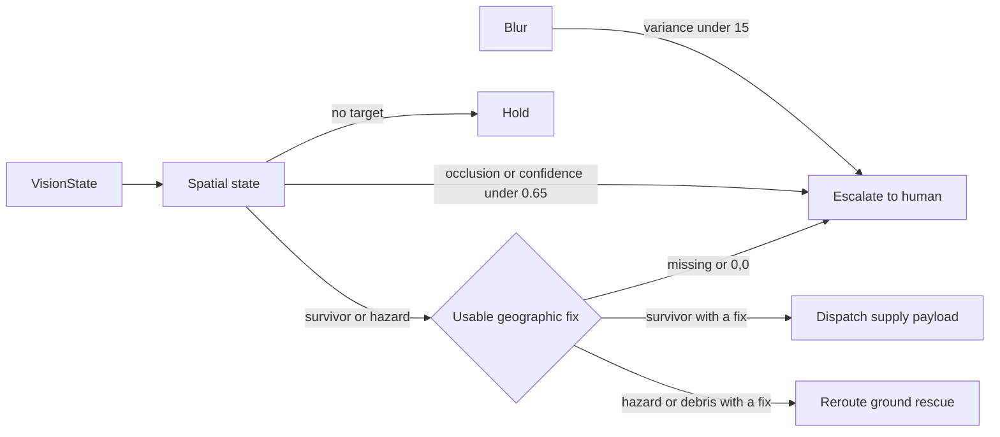
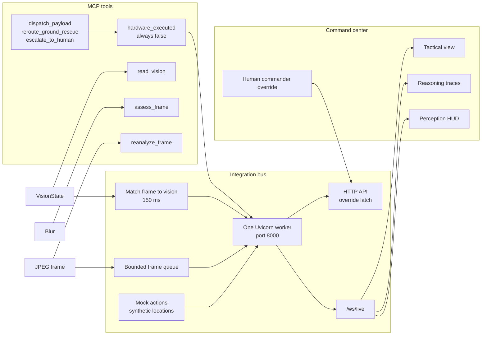
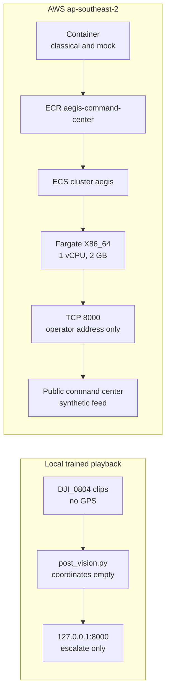

# Aegis architecture

## 1. From video to a detection

This is the perception path. OpenCV 5 takes one video source and prepares the frame. The live detector stays classical unless `AEGIS_DETECTOR=trained`. The trained path is YOLO11n for person and boat only, at confidence 0.45, and its weights stay on the workstation. Both paths end in one `VisionState`. The dotted Kinesis arrow is a planned input. That stream was not created.

## 2. From a detection to one action

`decide()` returns at most one outcome. A blurred frame, an occluded frame, or confidence below 0.65 always goes to a human. A survivor can dispatch a supply payload, and a hazard can reroute ground rescue, only when that box has a real location. Missing coordinates and `0,0` are not locations, so those frames escalate. A frame with no person and no hazard holds.

## 3. From the action to the operator screen

The MCP tools record the decision. `hardware_executed` stays false, so nothing here flies a drone or drives a boat. One Uvicorn worker matches each JPEG frame to its `VisionState` and pushes the pair over `/ws/live`. The command center draws the video, the reasoning trace, and the tactical view. The commander can latch an override and block later autonomous submissions. Mock actions add synthetic locations. That path is what the AWS page uses to show dispatch, reroute, and escalate.

## 4. Where the two demos run

These are separate processes. The local page plays a held-out DJI clip through the trained model. Those clips have no GPS, so the trace escalates. The AWS page is the container on Fargate in `ap-southeast-2`: classical detector, synthetic scene, TCP 8000 open only to the operator address. It does not contain the trained weights.

